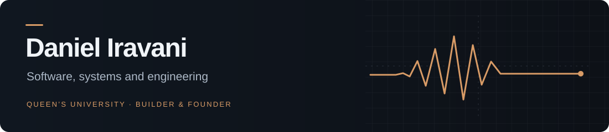

**Computer Engineering student at Queen’s University. Founder of StudyScope and EnTerra Scientific.**

I build learning software, data systems, and tools for technical work. My projects span web applications, Apple apps, workflow automation, and engineering simulation. I’m interested in the whole system: the interface people use, the data behind it, and the software that connects it to the real world.

  <a href="https://danieliravani.com">Portfolio</a> &nbsp;·&nbsp;
  <a href="https://danieliravani.com/projects">Project case studies</a> &nbsp;·&nbsp;
  <a href="https://danieliravani.com/contact">Get in touch</a>

## Selected work

| Project | What I’m working on |
| :--- | :--- |
| **[StudyScope](https://github.com/DanielIravani/studyscope)** | Education software connecting curriculum, question practice, flashcards, tests, tutoring, and classroom workflows. Founder and lead product architect since 2023. [Website](https://studyscope.ca) |
| **[Gavell](https://github.com/DanielIravani/gavell)** | Software for intellectual property notices, professional review, client instructions, and completion records. [Website](https://gavell.ca) |
| **[EnTerra Scientific](https://github.com/DanielIravani/enterra-scientific)** | Applied engineering, robotics and hardware concepts, alongside custom software and technical tooling. Founder and technical lead since 2025. [Website](https://enterrascientific.com) |
| **[Iordis](https://github.com/DanielIravani/iordis)** | A student note-taking and study product in development, with a public site, account system, and sample study workspace. [Website](https://iordis.com) |
| **[ParkSolver](https://github.com/DanielIravani/parksolver)** | A desktop workbench for parking layouts, geometric constraints, circulation, and scenario comparison. Built with a React interface, Electron shell, and C/TypeScript solver. |
| **[Engineering portfolio](https://github.com/DanielIravani/engineering-portfolio)** | An interactive portfolio documenting my software and engineering work, built with React, TypeScript, and Three.js. [Visit](https://danieliravani.com) |

## Tools I work with

  
  
  
  
  
  

- **Web and data:** TypeScript, JavaScript, React, Next.js, Node.js, PostgreSQL, Prisma, and API design.
- **Applications and tooling:** Python, Swift, SwiftUI, Electron, data ingestion, and workflow automation.
- **Verification and delivery:** Playwright, Vitest, GitHub Actions, and application deployment.
- **Engineering studies:** C++ through coursework, introductory CAD, hardware prototyping, sensing, and robotics.

## How I approach a build

I start with the workflow and make the system’s state and responsibilities explicit. Then I work through the interface, API, database, and deployment, testing saved state, permissions, and failure cases along the way. The project overviews above describe the implementation choices and current scope of each build.

For internships, engineering projects, or a conversation about something I’m building, [get in touch through my portfolio](https://danieliravani.com/contact).
